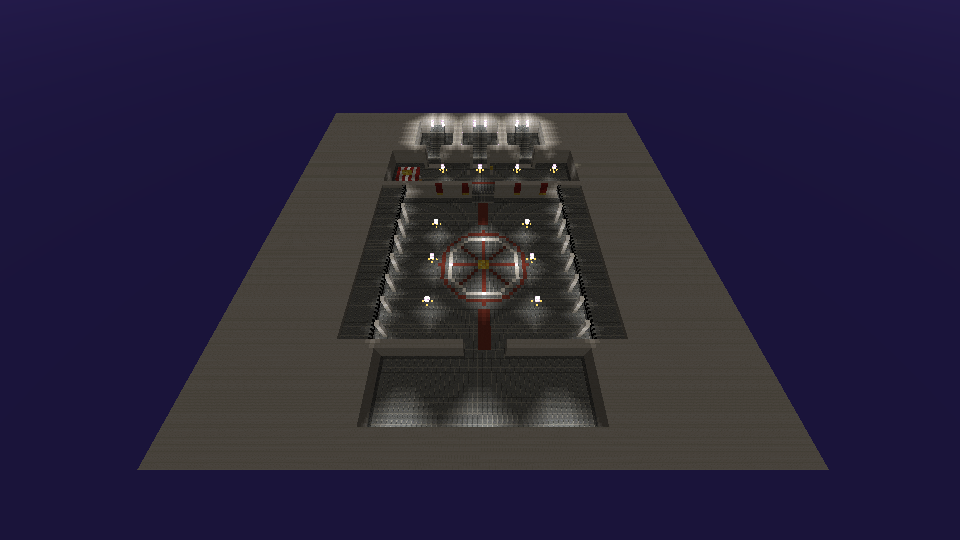
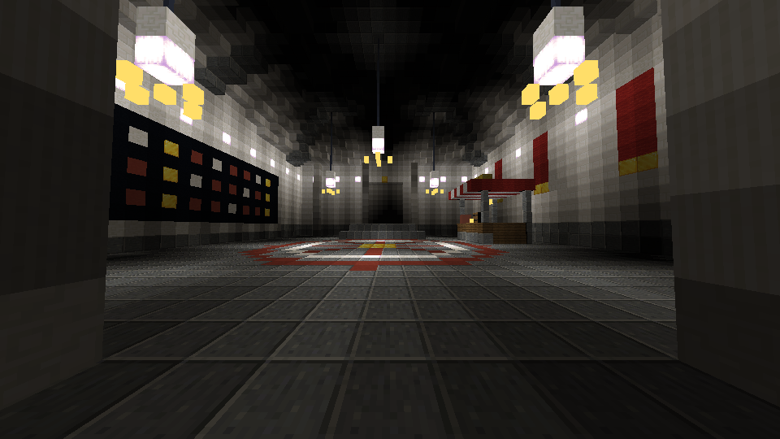
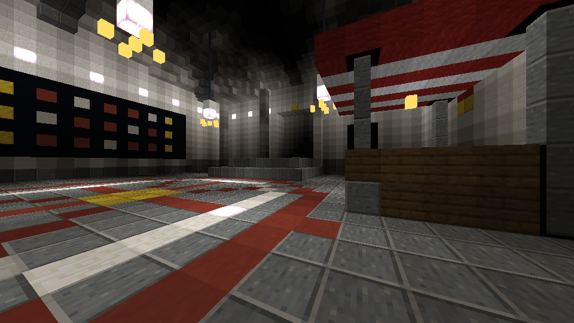
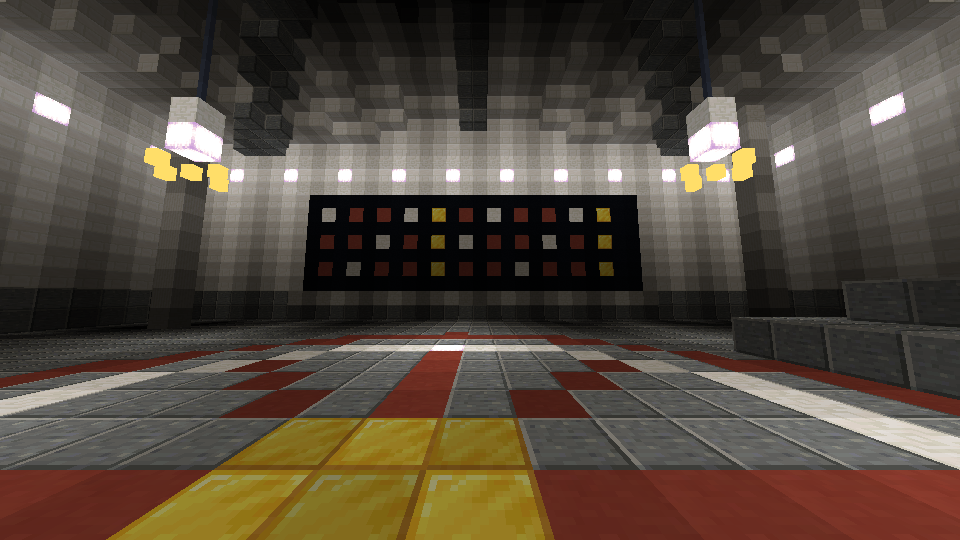
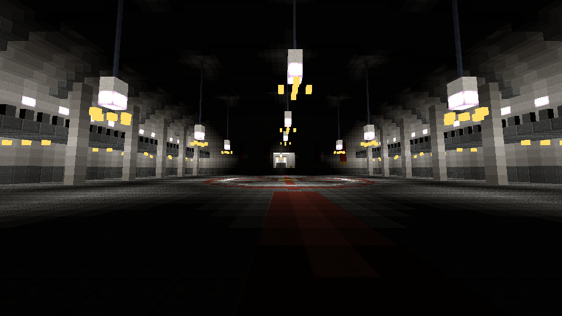
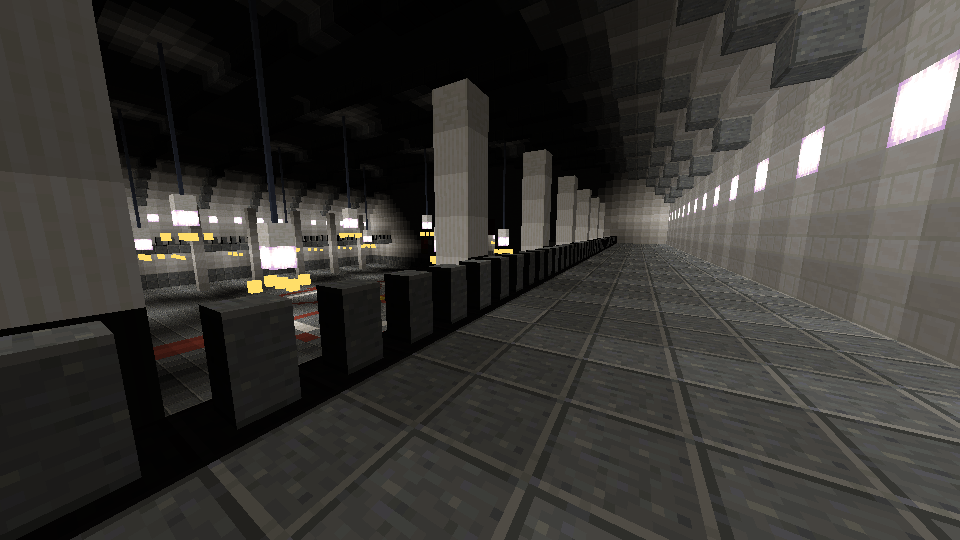
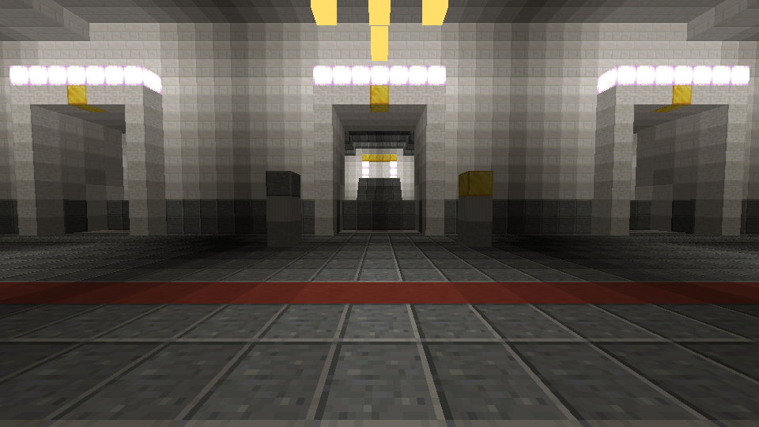
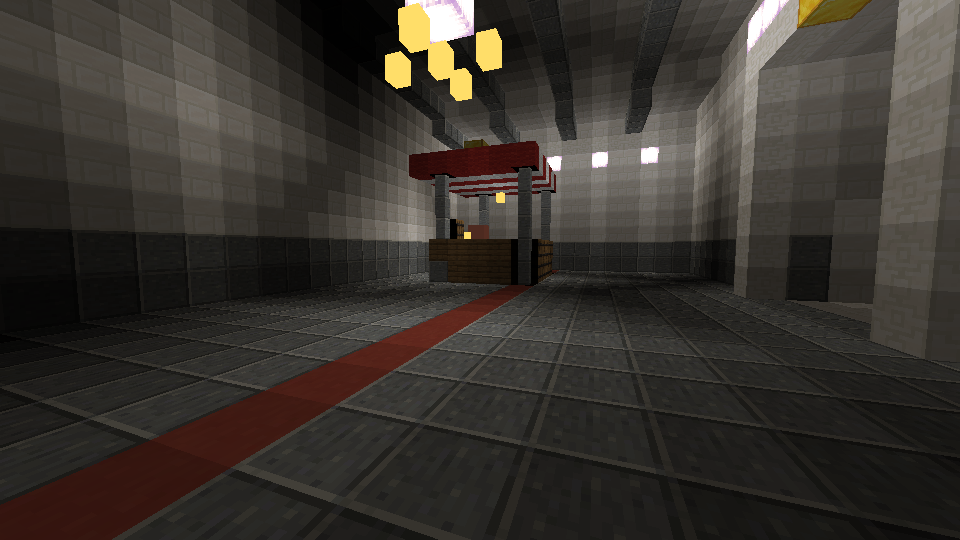
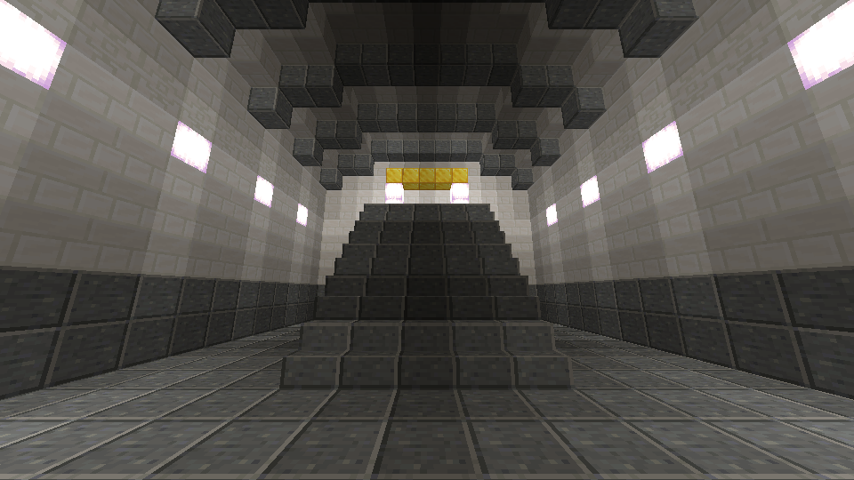

# P59: Neutral tower makeover (route, pedestals, grand interiors, prep room, vendor stand)

Status: **2026-11-13: design agreed except Neutral's palette; nothing built.** Concept pictures are rendered from a rough voxel model
(`tools/neutral_tower/concept.py`), not from a generator. Neutral is the test case; Duskvale, Rootvale, Tideforge and Poke Tower follow
once Neutral has been walked on the rig.

## Owner decisions (2026-11-13)

| Question | Answer |
|---|---|
| Halloween | **Archive, don't delete.** |
| Which towers get the makeover | **All of them**, one at a time |
| First tower | **Neutral** |
| Can the floor footprint grow | **Yes** |
| Interiors | Grand and memorable, not flat ceilings |
| Stairs | A fade transition on every staircase |
| Start of a run | A **preparation room** so players are not thrown straight in |
| Vendor | The regular vendor NPC gets a **shop stand** |
| When the key is taken | **On the teleport into the tower dimension** (with the prep room: on arrival in the prep room), not when floor 1 starts. Leaving the prep room or timing out does not give it back. |
| Hidden blocks | Players never see the outside, so **trim every block they cannot see** |
| Building layout | **Two acts** (option B) |
| Prep timeout | **5 minutes** from arrival |
| What the prep stand sells | **Run supplies only** |

## What exists today (measured 2026-11-13, `origin/main` d261212)

* **Halloween is already archived.** `towers/halloween.json` has `"window": {"end": "2026-11-12T05:00:00Z"}`. Since then `LobbyService`
  and `RunFactory` refuse new runs, `TowerContent.openCatalogTowers` hides it, and `listedTowerIds` still lists it for players who played
  it, so their progress stays visible (P54). The Halloween-only systems (`TrickDoors`, the vault, the witch vendor through
  `VendorNpcRules.WITCH_TOWERS`, the Trick or Treat stop picked when `tower.window().isPresent()`) only switch on in that tower.
  **Nothing to build**; reopening next year means new window dates. The pieces made for Halloween that are not Halloween-specific
  (lane stairs and fades from P58, reused pedestals with accept on the right, the route map, the Mystery Bag, the rest-refusal purse) are
  what this makeover carries over to other towers.
* **Neutral is the old single-arena layout.** All ten floors use one structure, `battle_tower_neutral` (93 x 163 x 87, about 1.32 M
  voxels in the box, 325 k stored blocks), and each floor's `layout` has only `entry`, `presentation`, `spectator` and `exit`. Neutral has no `doors`, no `route_map` and no
  `pedestal_votes`. The party is teleported from floor to floor.
* **The runtime can already change buildings between floors.** `RunLifecycle.changedLayout` notices when the next floor's `structure`
  differs and `prepareNextFloor` starts building it **in slices in a cell of its own** while the party walks (PR #22). So a tower does not
  have to be one structure.

## The proposal in one picture



*One standard floor, cut at head height, seen from the north end: the arrival hall (bottom), the vaulted battle hall with the medallion
and the side galleries, gate A, the atrium with the vendor stand (far left) and three grand doors, and the three lane rooms (top) with their
stairs and threshold arches.*

### Flow of a run

1. **Lobby → preparation room** (new). The party lands in the prep room, a domed hall: vendor stand (run supplies only), route-map wall, and the
   great door to floor 1 with the **ready dais** in front of it.
2. **Ready.** Everyone stands in the gold ring on the dais. The door opens when the whole party is in the ring **and** Act I is built.
   Walking through the door fades and teleports the party to floor 1's arrival hall.
3. **Each floor:** arrival hall → battle hall (the fight) → gate A → atrium (vendor stand, the shared pair of pedestals, three grand doors)
   → the chosen lane room → its five-step stair → the threshold (**fade and teleport**) → the next floor's arrival hall, dressed for the
   lane taken. This is the P58 flow, unchanged, on a new building.
4. **Floor 5** is the crown of Act I: the boss hall, with the tallest room in the building. Leaving it fades into Act II.
5. **Floors 6 to 10** are Act II, with floor 10 as its crown.

### Building layout: two acts, not one tower (recommended)

Block counts below are **stored blocks after trimming** (see "Trim what nobody sees"). A standard floor keeps about 36 k as a bare shell;
about 45 k is allowed here for dressing. Today, for comparison, Neutral stores 325 k and the Halloween tower 905 k.

| Option | Box | Stored blocks per build | Builds per run | Notes |
|---|---|---|---|---|
| A. One stack, 10 floors + prep at a 24-block pitch | 112 x 264 x 112 | about **0.5 M** | 1 | Affordable once trimmed, but the boss crowns sit mid-stack and their height pushes the cell's ceiling |
| **B. Two acts** (prep + floors 1–5, floors 6–10) | 112 x 120 x 112 | about **0.25 M** each | 2 | Act I is built while the party is in the prep room, Act II during the floor 5 intermission |
| C. One building per floor | 112 x 24 x 112 | about **45 k** | 10 | A second cell is held at every floor change, and floors stop feeling like one building |

**B is still recommended**, though trimming makes A affordable too. B matches how the route map already reads (Act I on the left, Act II
on the right), and each act's top floor has nothing above it, so the boss crowns can rise as high as they like. Each build is also smaller
than today's Neutral tower and has a natural pause to hide in.

### Room sizes (standard floor; footprint 112 x 112, pitch 24)

| Room | Interior | Height | Notes |
|---|---|---|---|
| Arrival hall | 44 x 14 | 8, ribbed | Three landing arches on the north wall, one per lane, each dressed for its lane (P58 `LaneArrival`). Kept low on purpose. |
| Battle hall | 60 x 48 | 11 at the walls, **19 at the ridge** | Barrel vault with ribs every 6; quartz piers in two lines; side galleries at +6 for spectators; inlaid medallion at the arena centre; chandeliers. |
| Atrium | 60 x 16 | 9 → 12 | Flatter vault with ribs every 4; vendor stand at the east end; three grand doors (5 x 7, trim frame, gold keystone, light lintel) on the south wall; the shared pair of pedestals stands in front of the chosen door, accept on the player's right. |
| Lane rooms | 13 x 16 each | 7 → 11 | Low vaults, so the atrium feels big by contrast. Each holds its stop room's dressing and a five-step stair to a threshold arch with a mist curtain. |
| Prep room (Act I only) | 40 x 32 | 13 → **19**, dome | Eight radial ribs and one ring; route-map wall north; vendor stand south; ready dais and great door east; the way in from the lobby west. |
| Boss crowns (floors 5, 10) | about 64 x 56 | **28+** | Not modelled yet. The tallest rooms in the tower; the next concept to draw. |

### Pictures

| | |
|---|---|
|  Prep room from the entrance: route map left, stand right, dais and great door ahead. |  The ready dais beyond the stand. |
|  Route-map wall (blocks stand in for the 3D icons). |  Battle hall from the arrival end. |
|  The spectator gallery. |  Atrium: three grand doors; the pair of pedestals in front of the chosen one (gold = accept, right). |
|  The vendor stand at the atrium's east end. |  A lane room: five steps to the threshold. |

The renderer has no smooth lighting and no entities (no vendor, holograms or icons), so real rooms will look brighter and fuller. The
lighting still has to be checked on the rig (see "Lighting rule").

## Theme files (how the other four towers follow)

Every room is built from **roles**, not blocks: `wall`, `wall_low`, `pier`, `trim`, `vault`, `rib`, `floor`, `inlay`, `accent`, `hanging`,
`light`, `glass`, `wood` (see `PALETTE` in the concept). A tower's theme file maps roles to blocks and adds one or two **signature
pieces** (Tideforge: a water channel down the battle hall; Rootvale: roots through the vault; Duskvale: a star-glass crown). One
generator and five theme files, not five hand builds.

Themes live with the generator, in `tools/tower_gen/themes.py`: one dict per tower. The blocks are baked into the `.nbt`, so the mod never reads a theme.

The stop rooms (`room_*.nbt`) are built in the Halloween palette (polished blackstone). They need re-theming through the same roles, or
Neutral's lane rooms will look like Halloween.

## Contract changes

* **Tower JSON:** Neutral gains `"route_map": true`, `"pedestal_votes": true`, a `"theme": "cobbletowers:neutral"`, and a new
  `"prep": { "structure": ..., "entry": ..., "dais": <box>, "door": <box>, "vendor": <anchor> }`.
* **Floor JSON:** floors 1–5 use `structure: cobbletowers:neutral_act1` and floors 6–10 use `neutral_act2`, each with its own anchors
  and the P58 `doors[]` (`open`, `frame`, `pedestal`, `stair_top`, `arrival`), as Halloween already has. The `vendor` anchor moves from
  `exit` to the stand.
* `validate_definitions.py`: the dais and door lie inside the prep structure; every `arrival` lies in the next floor's arrival hall.

## Runtime changes

| Piece | Change |
|---|---|
| Prep room | **New.** The prep room is its own small structure (about 50 x 22 x 42, 46 k voxels): pasted at once, or taken from the warm pool, *beside* Act I in the same cell, and Act I is built in slices after it (a new two-structure job in `RunBuildJobs`). Without this the prep room could not hide the build: it would be inside the thing being built. |
| Ready dais | **New.** It counts the party members standing in the ring, and the door opens when everyone is in **and** the Act I job is done. While the build runs, the door shows "the tower is being prepared" with progress. A short countdown, then the fade. |
| Key taken on entry | **Moves with the teleport.** Today the key is checked again and taken in the same tick just before floor 1 opens (audit fix dc6d201, `LobbyLaunch.afterAllocation`), and opening floor 1 is what teleports the party into the tower dimension, so today "on entry" and "as floor 1 opens" are the same moment and **nothing changes until the prep room exists**. With the prep room, the same check-and-take moves to just before the teleport into it. The refund stays only for a teleport that fails; leaving the prep room or timing out gives nothing back. |
| Prep timeout | **New: 5 minutes from arrival** (owner, 2026-11-13). A bossbar counts down; at 0 the run closes, the party is returned to the lobby with their Pokemon restored, and the cell is freed. The key was spent on arrival and is not given back. A party that is ready and waiting only for Act I to finish building is not timed out. |
| Fades | Already on every P58 stair threshold. Add them to prep → floor 1 and floor 5 → Act II. |
| Prep stand stock | **Run supplies only** (owner, 2026-11-13): today that is Full Heal (25 CD) and Cure Status (10 CD). The Mystery Bag is sold only at the atrium stands. A service file gains a `"sold_in"` list (`prep`, `atrium`), defaulting to `atrium` only. There is **no free healing font** in the prep room, because it would undercut the paid Full Heal. |
| Vendor stand | The vendor stands behind the counter at the `vendor` anchor. The goods on the counter are **Polymer display entities shown to the party**, not item frames or real items, so nothing on the stand can be taken. |
| Act change | Floor 5 → 6 uses the existing next-floor-cell path (`prepareNextFloor`), started as soon as the floor 5 intermission begins. |

## Trim what nobody sees (measured 2026-11-13)

A cell is cleared before every build (`CellPreparer.reset`, or the sliced reset in `SlicedBuild`), and a structure does not store its air
(`schem_to_structure.py` leaves it out). So the paste only has to place blocks a player can see, and the next reset only has to clear
them. **Both costs scale with stored blocks, not with the size of the box.** Air-only chunk sections are also skipped by the reset.

**Rule for the generator:** keep a full opaque block only if open space (air or a see-through block: glass, slabs, stairs, bars,
lanterns, ...) lies within **2 blocks** of it, counting diagonals. Everything deeper is left out. Two blocks rather than one keeps walls
solid to the eye at corners and behind trim, and a dropped block cannot open a hole.

| Building | Solid in the box | Kept with a 1-block shell | Kept with a **2-block shell** | 3-block shell |
|---|---|---|---|---|
| Concept standard floor (112 x 24 x 112) | 231,506 | 22,530 (10%) | **36,013 (16%)** | 49,235 (21%) |
| Concept prep room (50 x 22 x 42) | 25,878 | 6,279 (24%) | **11,238 (43%)** | 16,150 (62%) |

The same rule on today's towers (a block is see-through by name; anything outside the box counts as open):

| Structure | Stored | Trimmable | |
|---|---|---|---|
| `battle_tower_neutral` | 325,072 | 41,943 | 13% |
| `battle_tower_duskvale` / `rootvale` / `tideforge` | about 325 k each | 42 k to 45 k | 13–14% |
| `battle_tower_halloween` | 904,848 | 276,502 | 31% (archived, so moot) |
| `poke_tower` | 15,103 | 0 | 0% |

The current regional towers are already mostly hollow, so trimming them saves little (about 13%). The big win is building the new ones
as shells from the start: a solid-mass build would store about 6x more blocks.

**Consequences:**
* **The validator checks that the shell is closed.** Every open cell a player can reach has only open cells or kept blocks on its six
  sides, so no room looks out into the void. This is a new check next to the P55 flood fill.
* **No real windows.** There is nothing outside to see (and the cell around a trimmed build is air). A window is **backlit glass**: glass
  with a light block behind it, both inside the shell. The concept's light coves already work this way.
* **Torches and lamps outside the shell** are gone along with everything else, so all lighting lives inside the rooms (see "Lighting rule").

## Lighting rule (found while rendering)

Block light drops one level per block. A lamp in a 19-high vault leaves the floor almost dark (the first renders were). Grand halls need
light **brought down to the people**: chandeliers hanging to about 7–9 above the floor, lamps under the gallery decks, flush lights in the
floor inlays. Wall coves alone are not enough. This also keeps mobs from spawning in big rooms, though cells should not spawn mobs anyway.

## Exploit notes (minecraft-exploit-audit, design mode)

* **Prep-room purchase loops: closed by the owner's decision.** The key is spent on the teleport into the prep room, so opening a run to
  buy the per-run-limited Mystery Bag (2 per run) and leaving costs a key every time. The per-run limit stays as it is.
* **Holding cells:** the prep timeout (above), counted from arrival, not from the last movement.
* **The ready ring is server-checked by position.** A player standing outside the ring cannot be counted as ready by a client packet.
* **Display goods** are virtual. The stand has no container a player can open other than the vendor's own menu.
* **Galleries:** spectator galleries must not let a fighter step down into the arena from above mid-battle, or skip to gate A. The P55
  flood-fill validator gets one rule for this: from a gallery there is no path into the arena floor or the atrium.

## Open questions for the owner

1. ~~Prep timeout~~: 5 minutes (answered 2026-11-13).
2. ~~What the prep stand sells~~: run supplies only (answered 2026-11-13).
3. ~~Two acts~~: yes (answered 2026-11-13).
4. **Neutral's identity:** the palette (see `PALETTE` in `tools/neutral_tower/concept.py`) and its signature pieces. Still open.

## Build order

1. ~~Owner answers to the open questions~~ (done 2026-11-13); the palette is still open.
2. Generalise `tools/halloween_tower/hollow_tower.py` into a themed tower generator (module library, roles, its flood-fill validator, the
   2-block shell trim and the closed-shell check), and generate `neutral_act1`, `neutral_act2` and `neutral_prep`.
3. Isometric and eye-level previews of the generated buildings, including the boss crowns, for owner approval **before** anything goes
   on the rig.
4. Runtime: the prep structure and two-structure build job, the ready dais, the timeout, the act-change fade, and the vendor at the stand.
5. Rig walk (`walk_tower_test.py` rewritten for the new layout): a full run, the fades, lighting in a real client, paste times for both
   acts.
6. Then the other four towers: one theme file each, plus their signature pieces.

## As built: the generator (2026-11-13)

`tools/tower_gen/` builds the three Neutral buildings from roles, trims them, validates them, and writes vanilla `.nbt` (DataVersion 3955)
plus a layout JSON. **Not yet installed in the mod and not wired to the runtime.** No floor or tower JSON has changed, and Neutral still runs
on `battle_tower_neutral`.

```
py -3.14 -I tools/tower_gen/tower_gen.py             # build, validate, write validation/schematics/neutral/
py -3.14 -I tools/tower_gen/tower_gen.py --install   # also copy the .nbt into src/main/resources/data/cobbletowers/structure/
py -3.14 -I tools/tower_gen/test_tower_gen.py        # 13 tests: the good tower passes, 7 mutations each fail with the right complaint
py -3.14 -I tools/tower_gen/preview.py docs/design/P59   # the gen_*.png pictures
```

| File | Box | Stored blocks | Kept by the trim |
|---|---|---|---|
| `neutral_act1.nbt` (floors 1–5) | 66 x 130 x 118 | 221,054 | 34% of 646,079 |
| `neutral_act2.nbt` (floors 6–10) | 66 x 130 x 118 | 218,867 | 34% of 646,997 |
| `neutral_prep.nbt` | 56 x 26 x 44 | 13,302 | 31% of 43,444 |

Each act stores fewer blocks than today's whole Neutral tower (325 k).

**Two runtime contracts shaped the plan** (both are checked by the tests):
* **The party walks north.** `RoomDresser` clears and dresses the 11 x 15 x 8 box directly north of each door's opening
  (`back = door.open().minZ() - ROOM_DEPTH`). So the chambers are exactly that box, and each lane's stair sits *behind* its chamber
  (as in the Halloween tower), never inside it, or the dresser would wipe it. A test reads `ROOM_WIDTH`, `ROOM_HEIGHT` and `ROOM_DEPTH`
  from `RoomDresser.java`.
* **The vendor stand faces south, with open floor two rows in front of the vendor**, because `TowerGates.rescueFromGallery` stands rescued
  spectators at the vendor's spot + 2.5 z.

**What the validator checks per floor:** every anchor is standable; the battle hall is reachable from the entry; the vendor is not reachable
with gate A shut and is with it open; no chamber is reachable with its door shut; through door *i* only chamber *i* and threshold *i* are
reachable; the walk never leaves its floor; each lane's arrival (in the next floor's building, including floor 5 into Act II) reaches the
next battle hall but not its vendor; the gallery can't be walked to from the arena or the other way; the gallery rail has no gaps; the
dresser's boxes are empty air; floor 10 has no way up. Per building: the rooms' open space never touches the edge of the box or a trimmed-away
block. In the prep room: the dais is reachable; the threshold is reachable only through the great door.

**Generated pictures:** `gen_plan_floor1` (floor 1 cut at head height), `gen_arrival`, `gen_battle_hall`, `gen_crown_hall` (floor 5),
`gen_gallery`, `gen_atrium`, `gen_stand`, `gen_chamber_stair`, `gen_threshold`, `gen_prep`, and `gen_shell` (what is actually stored: the
outside is shells, not a tower).

**Still to do, in order:** the owner's palette (`TODO(human)` in `tools/tower_gen/themes.py`); the stop rooms (`room_*.nbt`) re-themed for
Neutral; lane dressing for the arrival arches; the runtime work in "Runtime changes" (prep structure, the two-structure build job, the ready
dais, the timeout, the floor 5 → Act II move through `prepareNextFloor`, the vendor at the stand); then install, point Neutral's floor JSON at
`neutral_act1`/`neutral_act2` with the generated anchors, and walk it on the rig.

## As built: the runtime (2026-11-13)

On branch `design/p59-neutral-makeover`, uncommitted, **not yet run on the rig**. `./gradlew test` passes (1,255 tests, 14 new),
`validate_definitions.py` passes (216 anchors on solid ground), and the architecture, API-boundary and persistence validators pass.

**Neutral now runs on the new buildings.** `tower_gen.py --install` put `neutral_act1`, `neutral_act2` and `neutral_prep` in the mod.
`tools/tower_gen/apply_layout.py` wrote the generated anchors into `floors/neutral/floor_01..10.json` and turned on `route_map`,
`pedestal_votes` and `prep` in `towers/neutral.json` (revision 3). The old `battle_tower_neutral.nbt` is still in the mod, unused.

| Piece | Where | What it does |
|---|---|---|
| Prep room definition | `definition/PrepRoom.java`, `TowerDefinition.prep` | `"prep"` in a tower file: structure, `entry`, `vendor`, `dais`, `door`, `threshold`. |
| Placement | `instance/PrepPlacement.java` | Pastes the prep room centred under the floor-1 building, 32 blocks below the build floor. The cell reset now clears down to there (`CellPreparer.RESET_BELOW`), so the room is cleared with the cell. The dimension is void, so nothing else is touched. |
| The room | `prep/PrepRoomService.java`, `prep/PrepRules.java` | Places the room, teleports the party in, spawns the vendor, shows a 5:00 boss bar (red at the last minute). Everyone in the gold ring opens the great door. Everyone on the threshold fades, and floor 1 begins. At 0:00 the run ends: the existing exit sweep sends the party home and returns their Pokémon, and the key is not refunded. |
| Key on entry | `LobbyLaunch.afterAllocation` | The keys are taken in the same tick the party is teleported into the prep room. Refunded only if floor 1 then fails to open. If the room can't be placed, floor 1 opens directly, as before. |
| Prep stand | `VendorPlace`, `sold_in`, `VendorNpcRules.openPlace` | One rule says where a run's vendor is open: the atrium at an intermission, the prep stand while the party is in the prep room. The NPC, the catalog and the purchase all use it. Full Heal and Cure Status have `"sold_in": ["atrium", "prep"]`. The Mystery Bag is atrium only. Buying elsewhere answers "not sold here". |
| Floor 5 → Act II | `WalkRules.climbsAcross`, `RunLifecycle.climbBuild` / `moveAhead`, `IntermissionService` | A lane stair may now climb into another building of the run's **own** tower; detours are still reached by teleport. Act II starts building as the walk begins. The fade waits until it is built ("The way up is being prepared..."). At the fade the run moves into the new cell, the team lands at the lane's arrival in Act II, and floor 6 opens without building again. If the build fails, the old path (rebuild in place) takes over. |

**Changed from the design:** the prep room **does not hide the Act I build**. The party waits in the lobby while Act I builds, as
today, and enters the prep room once it is up. Pasting the prep room first would have meant a new two-structure build job that pastes
after the cell reset but before Act I. That is a riskier change, and the trimmed Act I builds much faster than the old tower anyway.
As a result, the "a ready party waiting on the build is not timed out" rule never comes up.

**Restart behaviour:** the prep sessions and the climbed-ahead marks are in memory. A restart parks every live run anyway (TDS #28), and
a parked run is closed when a player is online. A party caught in the prep room by a restart loses its key like any other interrupted
run.

**Still to do:** a rig walk of a full Neutral run (prep → floor 1 … floor 5 → Act II … floor 10), including the paste times of
both acts, the fades, the prep vendor and the lighting in a real client. Also: the stop rooms (`room_*.nbt`) re-themed for Neutral, the
palette (`TODO(human)` in `tools/tower_gen/themes.py`), and the other four towers.
